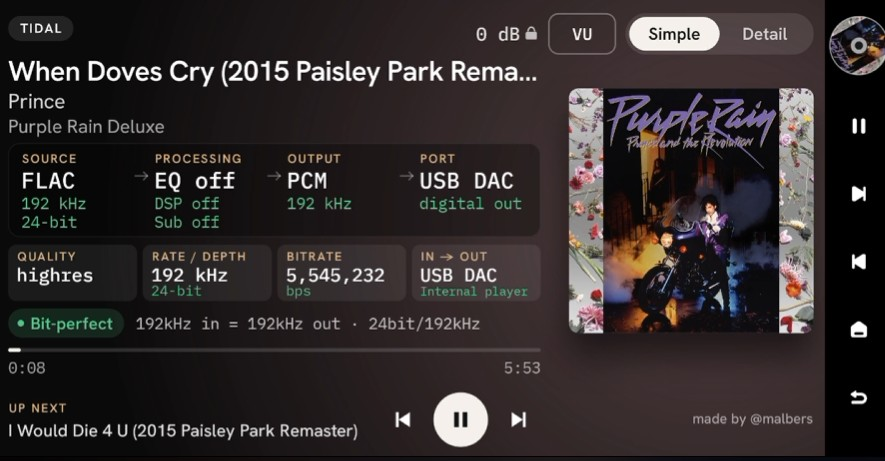

# EverSignal: now-playing stats for the Eversolo DMP-A6

**See every bit of your music, from the file to your DAC.** A free, read-only Android app that runs right on your Eversolo DMP-A6 streamer.

Are you a streaming nerd? Do you check the sample rate before the song title? Ever wondered whether that 24-bit TIDAL track really reaches your DAC untouched, or what your Eversolo is quietly doing to it on the way? **This player is for you.**

EverSignal is a now-playing screen for the Eversolo DMP-A6 that shows the whole signal path at a glance: what the source is, what the player does to it, what goes out and through which port. Then it tells you, in plain words, whether it's **bit-perfect**. One tap away there are five pages with every stat the player reports. Your music keeps playing exactly as before; EverSignal just shows you what's going on.

**It only reads. It never writes.** No settings changed, no files touched, nothing in your library edited. The only things it ever asks the player to do are the buttons you tap: play/pause, next, previous, and the VU screen.

**Contents**

- [Why did I build this?](#why-did-i-build-this)
- [What people are saying](#what-people-are-saying)
- [What you get](#what-you-get)
- [How to use it](#how-to-use-it)
- [What "Bit-perfect" means here](#what-bit-perfect-means-here)
- [What it never does](#what-it-never-does)
- [Download](#download)
- [How to Install](#how-to-install)
  - [Option A: from a USB thumb drive](#option-a-from-a-usb-thumb-drive)
  - [Option B: the Eversolo's upload page](#option-b-the-eversolos-upload-page)
  - [Option C: copy it over the network, then tap to install](#option-c-copy-it-over-the-network-then-tap-to-install)
- [Updating](#updating)
- [What's new](#whats-new)
- [Tested on](#tested-on)
- [More from the community](#more-from-the-community)
- [Feedback](#feedback)
- [Building from source](#building-from-source)
- [Credits](#credits)
- [Licence](#licence)
- [Also from me](#also-from-me)

## Why did I build this?

I always wanted to know what my DMP-A6 actually sends to my DAC. Is that TIDAL track really bit-perfect, or is something resampling it on the way? The player knows, it just doesn't show you. I was curious how much I could pull right on the device, and it turned out to be a lot. So I built a free app for it.

> **Made by Michael Albers.** I make honest videos about budget audio equipment, including a lot of Eversolo DMP-A6 how-tos. If you like this app, come find more on my YouTube channel: **[youtube.com/@malbers](https://www.youtube.com/@malbers)**

| The stock player screen | The same track in EverSignal |
|---|---|
| 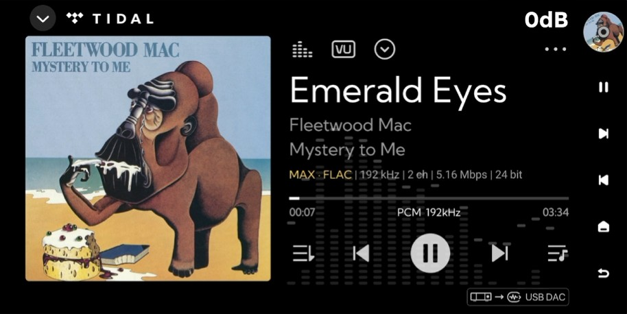 |  |

## What people are saying

### Real use: the DSD that wasn't native

Martin M. was playing a DSD file (DSF, 2.8 MHz) to his amp over HDMI and assumed it was going out as native DSD. EverSignal showed otherwise: the badge read **DSD → PCM**, so the player was converting it on the way out. After checking the A6's HDMI DSD setting and a restart, EverSignal showed **DSD64, native**, all the way to the port. In his words: "working now after I did a restart bloody great app I like it."

That's what it's for: the player knows what it's doing to your music, it just doesn't show you.

### From the Eversolo Facebook groups

> "works perfectly on the T10. Bigger screen not fully used, but centred nicely"<br>
> **Steven C-H.**

> "A8 here, seems to work perfectly. Great work"<br>
> **Michael W. S.**

> "I've installed an apk using a USB, but not directly. So straightforward!"<br>
> **Steve G.**

**[See more comments ↓](#more-from-the-community)**

## What you get

### Simple: the couch view

Big, readable from across the room:

- **The signal path** in four steps: **Source** (FLAC, 192 kHz, 24-bit) → **Processing** (EQ, DSP, subwoofer) → **Output** (PCM, DSD or MQA, and its rate) → **Port** (XLR/RCA, USB DAC, HDMI, optical/coax).
- **A verdict badge:** Bit-perfect, Resampled, EQ active, Volume (when digital volume changes the samples), DSD native, DSD → PCM, MQA, Lossy. Tap it for exactly what it checks.
- **Stat tiles:** quality, sample rate and bit depth, the file's exact bitrate, file size, and which input goes to which output.
- **The source, always named:** TIDAL, Apple Music, Amazon Music, AirPlay, or Library for your own files.
- Play/pause, next, previous and up next, plus a **VU** button that switches the Eversolo's own screen to its VU meters.
- **made by @malbers** under the cover opens my YouTube channel, if you have a browser on the Eversolo.

| MQA from the library, sent to the DAC | EQ on: no longer bit-perfect, and it says so |
|---|---|
| 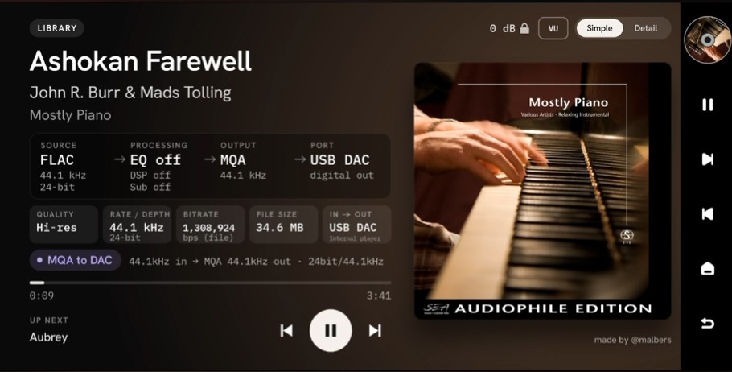 |  |

### Detail: stats for nerds

Tap **Detail**, then swipe left or right through five pages:

| Page | What's on it |
|---|---|
| 1. Overview | Music, signal path, device and today's session: hours listened, tracks, how much was hi-res, CD, DSD or lossy, the highest rate and the bitrate range |
| 2. Track & file | Where it plays from, credits, file details (exact bitrate, uncompressed rate, how much FLAC saved), library data, track flags |
| 3. Queue & playback | Position in the queue, what's up next with formats, the player's raw playback state and flags |
| 4. Device | Model, firmware, memory, storage, network, display settings and what the player says it can do |
| 5. Inputs, outputs & volume | Every input and output, the active output's own settings (filter, DPLL, DSD mode, MQA mode), what the DAC can take, the volume settings |

Anything the source doesn't report shows as N/A instead of being hidden, so you can see what each source does and doesn't give you.

Each page scrolls. Top and scrolled views:

| Page | Top | Scrolled |
|---|---|---|
| **1 Overview** |  | 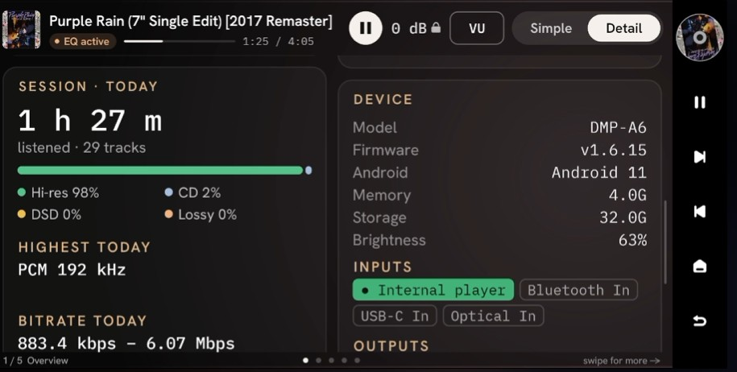 |
| **2 Track & file** |  | |
| **3 Queue & playback** | 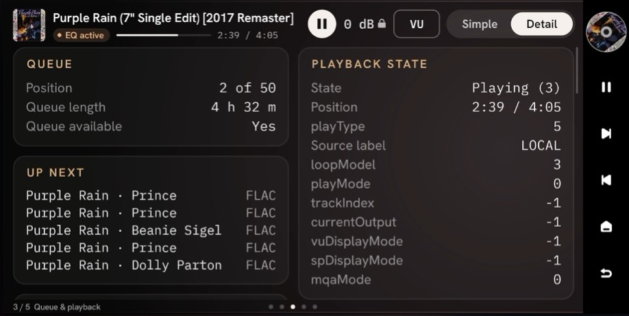 | 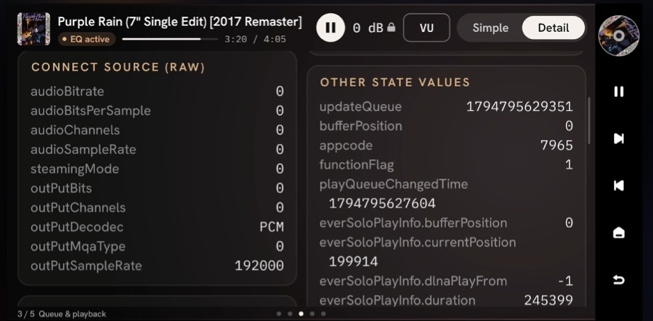 |
| **4 Device** | 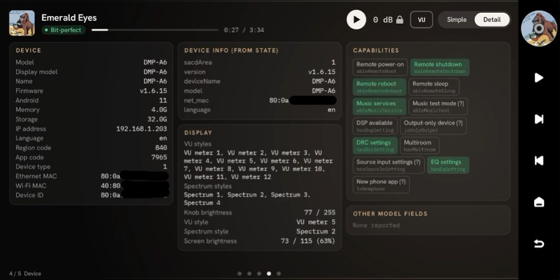 | 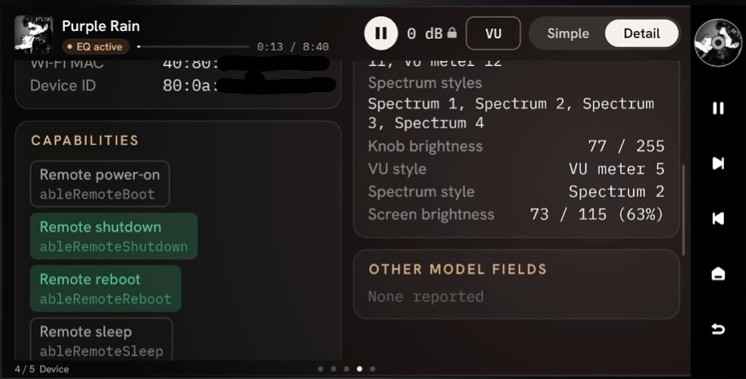 |
| **5 Inputs, outputs & volume** | 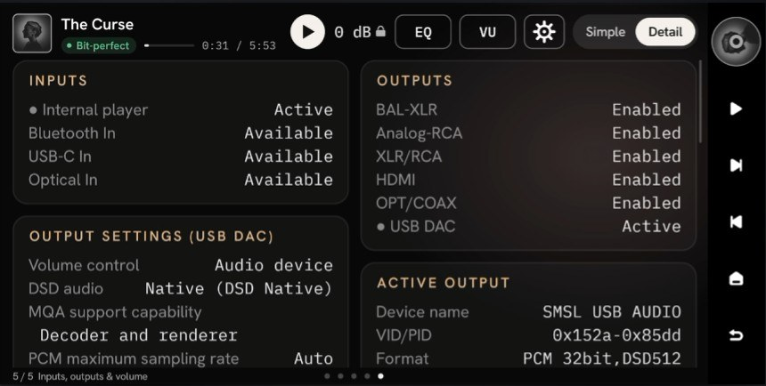 |  |

## How to use it

1. **Play some music** the way you always do: TIDAL, your library, the Eversolo phone app, AirPlay, anything.
2. **Press Home** on the Eversolo.
3. **Open EverSignal** from the **Apps** tab.
4. **Watch the stats.** Play/pause, next and previous work right there, and the Eversolo's own controls keep working as normal.

**Stay in front** (Detail, page 1, bottom right): starting a track from your phone or connecting AirPlay makes the Eversolo jump to its own player screen. With Stay in front on, EverSignal comes back by itself a couple of seconds later. The first time, Android asks you to allow **Display over other apps**; turn it on, go back, and tap Stay in front again. The Back button always turns it off, so the app can never trap the screen.

## What "Bit-perfect" means here

The badge says **Bit-perfect** only when all of these are true:

- PCM goes out at the source's own sample rate (no resampling)
- EQ and DSP are off
- The volume is at 0 dB or locked, because digital volume changes the samples (why Passthrough is recommended, ONLY if you have a DAC or downstream Amplifier that handles the volume downstream)

If one isn't "Bit-Perfect", the badge says which one (Resampled, EQ active, Volume −12 dB). What it can't check: the output bit depth (the DMP-A6 never reports it), and anything after the Eversolo's output, like the DAC or amp it feeds.

### The other badges

- **Resampled**: the player changes the sample rate on the way out (for example 44.1 kHz in, 96 kHz out), usually because of an upsampling setting or a fixed output rate.
- **EQ active / DSP active**: same rate in and out, but EQ or another sound effect is changing the samples.
- **Volume −12 dB** (or whatever it's set to): everything else is clean, but digital volume below 0 dB changes the samples. Turn on volume passthrough (0 dB) and use your amp's volume.
- **DSD native**: a DSD file goes out as DSD, untouched.
- **DSD → PCM**: a DSD file is converted to PCM on the way out, often because the output, or what's connected to it, is set to take PCM only. Check that output's DSD setting.
- **MQA to DAC**: the MQA stream goes to your DAC as is, for the DAC to unfold.
- **MQA unfolded ×2** (or ×4): the player unfolds MQA itself, to two or four times the stream's rate.
- **Lossy (MP3, AAC, …)**: the source itself is compressed with loss. Nothing further down the chain can bring that back.
- **Hi-res stream**: the streaming service says it's hi-res, but the player doesn't report what it sends out, so there's no verdict to give.

## What it never does

- **It never writes.** It reads what the player reports and shows it. It never changes a setting, never writes, moves or deletes a file, and never edits your library or tags. The only things it can tell the player to do are play/pause, next, previous, and switch its screen to the VU meters, and only when you tap them.
- It keeps a few small things in its own private app storage: today's listening totals for the Session panel, whether Stay in front is on, and the last update check. Nothing on your drives, unless you tap Update (below).
- It only talks to the Eversolo it runs on, through the player's local interface. Two exceptions: album covers (when a streaming service gives a cover link, the picture loads from that service's own server), and once a day it asks GitHub whether a newer EverSignal is out. That check sends nothing about you or your music.
- If a newer version is out, an **Update** pill appears under the cover. Only when you tap it does it save the new APK to the Eversolo's **Download** folder. It never installs anything by itself.
- The **Feedback** page (the last Detail page) shows a QR code to the feedback form. EverSignal sends nothing: your phone opens the form, and only if you scan it. The code fills in your model, firmware, EverSignal version and screen size, never your network address, MAC or device ID.
- No accounts, no analytics, no Google services. Nothing about you or your music is sent anywhere.
- It never shows the signed part of a streaming link. The **Device** page does show the player's network address, MAC addresses and device ID, because they're useful to you; blur them before you share a screenshot.

## Download

[**Download the latest EverSignal**](https://github.com/malbers/eversignal/releases/latest): on the release page, click `EverSignal-<version>.apk` under **Assets**. This link always opens the newest version.

Download it to your laptop or desktop, not to the Eversolo. The next section shows how to get it onto the Eversolo.

## How to Install

**What you're doing:** an `.apk` file is an Android app. The Eversolo runs Android underneath, so it can install apps that aren't in its app store, usually called "sideloading". It takes a couple of minutes and you only do it once.

**For Options B and C:** your computer and the Eversolo must be on the same home network.

### Option A: from a USB thumb drive

No network needed.

1. **Copy the APK onto a USB thumb drive** (FAT32, exFAT or NTFS, which covers almost any drive).
2. **Plug it into a USB port on the back of the Eversolo.**
3. **Open the Files app**, pick the USB drive in the list on the left, and go to the folder with the APK.
4. **Tap the `EverSignal-<version>.apk` file, then Install.** If it asks to allow installs from unknown sources, turn that on for Files.
5. **Tap Done**, then find it in the **Apps** tab.

### Option B: the Eversolo's upload page

1. **Find the Eversolo's address.** On the Eversolo, go to **Settings > Network Settings > Transfer**. Under **Method 1** it shows a web address that starts with `http://` and ends in `:9587`.

   

2. **Open that address on your computer** in any browser, including the `:9587` at the end. The Eversolo's upload page opens. Click **Upload Apk** at the right.

   

3. **Send the app.** Click **Select APK File** and choose the `EverSignal-<version>.apk` file from your Downloads folder. It uploads and installs by itself.

   

4. **Find it on the Eversolo** in the **Apps** tab on the home screen.

   

### Option C: copy it over the network, then tap to install

1. On the same **Transfer** screen, **Method 2** shows a network share address for Windows (starts with `\\`) and Mac (starts with `smb://`).
2. Open it on your computer: in Windows File Explorer type the `\\` address in the address bar; on a Mac use **Go > Connect to Server** with the `smb://` address (choose **Guest** if asked).
3. Copy the APK into any folder on the Eversolo, for example `Download` on the SSD.
4. On the Eversolo, open the **Files** app, go to that folder and tap the `EverSignal-<version>.apk` file. Tap **Install**.

   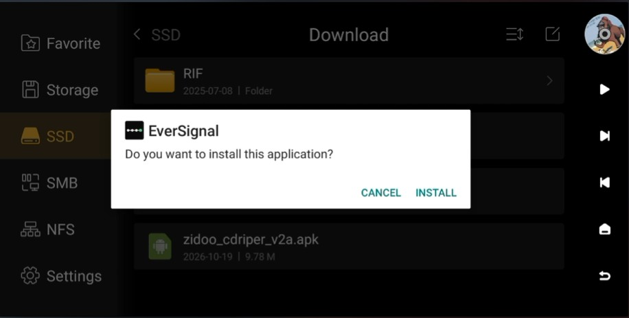

5. **Tap Open** to start it now, or **Done** and find it later in the **Apps** tab.

   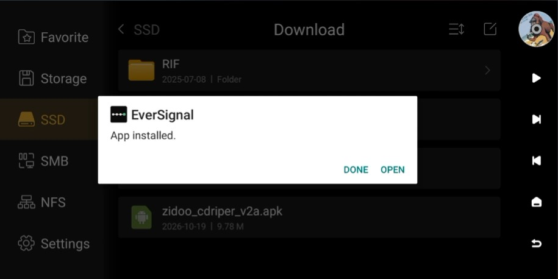

### Is this file really from me?

Every official release is signed with the same key. If you want to check a copy you got somewhere else, its SHA-256 certificate fingerprint should be:

```
351e63f51b6bed49f8e5282c2cf1427ce8bb5e7fee3558ab4899c5b6ca146ca2
```

An APK with a different signer did not come from here.

## Updating

From 1.0.1 on, EverSignal checks for a new version once a day. When one is out, tap **Update … · Download** under the cover. It saves the APK to **Download**. Then open **Files › Download**, tap the APK, and choose **Update**. Your settings stay. If you're on 1.0.0, install 1.0.1 by hand once, the same way you installed 1.0.0.

## What's new

**1.0.4** (16 November 2026)
- Fits wider screens: on the DMP-T10's long display, EverSignal now uses the full width instead of leaving bands at the sides. Simple stretches the signal path and tiles; Detail shows three columns. The A6 looks the same as before. Thanks to Steve C.-H. for sending his T10's screen size.
- Fixed: on models that list more inputs (the DMP-A6 Master Gen 2 has six), the Device panel on the first Detail page no longer runs its outputs into the "can do" line. Thanks to René G. C. for the report.
- Mouse wheel: scroll the Detail pages with a mouse wheel (for example through the Eversolo's PC control in a browser); a sideways scroll changes page.

**1.0.3** (16 November 2026)
- New **Feedback** page, the last Detail page: scan the QR code with your phone to send a bug, an idea, or "it works on my model". It fills in your model, firmware and EverSignal version for you.
- The **Device** page now shows the screen size and the area EverSignal gets, to help lay it out on other models (the T10's bigger screen is next).

**1.0.2** (15 November 2026)
- Bigger text, readable standing at the rack: Detail is drawn 1.8x larger in two columns, and every page scrolls (page 1 too).
- Simple: smaller cover, larger signal path, tiles and badge line; second lines in green, labels in tan.
- Larger Simple / Detail, VU and volume controls at the top right, easier to hit.
- Up next shows the format on the same line; long values wrap under their label.

**1.0.1** (15 November 2026)
- Update check: once a day it asks GitHub for the latest release, and shows an Update pill when a newer one is out. Tap it to download, no browser needed.

**1.0.0** (15 November 2026)
- First public release: Simple and Detail screens, the bit-perfect verdict, five stats pages, today's listening session, Stay in front.

## Tested on

Eversolo DMP-A6 (Gen 1), firmware 1.6.15, Android 11, with the library (FLAC, WAV, DSD, MQA, MP3), TIDAL, Apple Music, Amazon Music, AirPlay and TIDAL Connect, on XLR/RCA and USB DAC outputs. Owners report it working on the DMP-A6 Master Gen 2, DMP-A8, DMP-T8, DMP-T10 and the Play. It does not run on non-Eversolo Android boxes.

EverSignal is an independent app. It is not made by or affiliated with Eversolo, and it reads the player's undocumented local interface, which a firmware update could change.

## More from the community

More from the Eversolo Facebook groups:

> "Fantastico su T8 grazie !!!"<br>
> **Giuseppe V.**

> "Thanks for making this. Works perfect."<br>
> **Henri S.**

> "You sir are a clever little cookie"<br>
> **Martin M.**

> "I'm really enjoying this. Thanks!"<br>
> **Michael K.**

> "by the way, it looks like a great product. Thank you."<br>
> **David S.**

> "Pretty awesome!"<br>
> **Weston T.**

> "Congrats and Thanks for your APP."<br>
> **Patricio M.**

> "Very cool!"<br>
> **Lou S.**

> "Nice, thanks!"<br>
> **Emilio M.**

## Feedback

Found a bug, have an idea, or tried it on another Eversolo model? Easiest: open **Detail**, swipe to the last page, and scan the QR code with your phone. Or **[tell me here](https://docs.google.com/forms/d/e/1FAIpQLSdaQcFaXOcaRyZr520Lxir_NmPKtZG6aojfJ15XBwSbSB9ffQ/viewform)**. It's a short form, no account needed, and I read every one. If you're on GitHub, you can also [open an issue](https://github.com/malbers/eversignal/issues). A screenshot of the Detail pages helps a lot (blur the Device page first).

## Building from source

Java, plain Android SDK, no third-party libraries. JDK 17, then:

```
gradlew assembleRelease testDebugUnitTest
```

Release builds are signed with a key kept outside the repo (`scripts/new-signing-key.ps1`); without it they fall back to the debug key.

## Credits

Fonts: [Hanken Grotesk](https://fonts.google.com/specimen/Hanken+Grotesk) and [IBM Plex Mono](https://fonts.google.com/specimen/IBM+Plex+Mono), both under the SIL Open Font License 1.1 (licence texts in `app/src/main/assets/fonts/`). See [THIRD_PARTY.md](THIRD_PARTY.md).

## Licence

Copyright 2026 Michael Albers ([@malbers](https://www.youtube.com/@malbers)). Licensed under the [Apache License 2.0](LICENSE).

You're welcome to use it, modify it, build on it and send improvements. If you redistribute it or something built from it, keep the [NOTICE](NOTICE) file with it so the credit travels along. The licence doesn't cover the name: please don't publish a modified version as "EverSignal" or as coming from me.

Contributions are welcome. Anything you submit to this repository is accepted under the same Apache 2.0 licence.

## Also from me

Two more free apps for the DMP-A6:

- **[AddMyCoverArt](https://github.com/malbers/addmycoverart)** fills in missing album art on your ripped CDs, right on the Eversolo, and checks your rips for missing or cut-short tracks.
- **[FixMyRips](https://github.com/malbers/fixmyrips)** fixes the tags the Eversolo CD Ripper leaves broken, and tells you from your phone whether a CD is already ripped.

And the videos that go with all three: **[youtube.com/@malbers](https://www.youtube.com/@malbers)**
