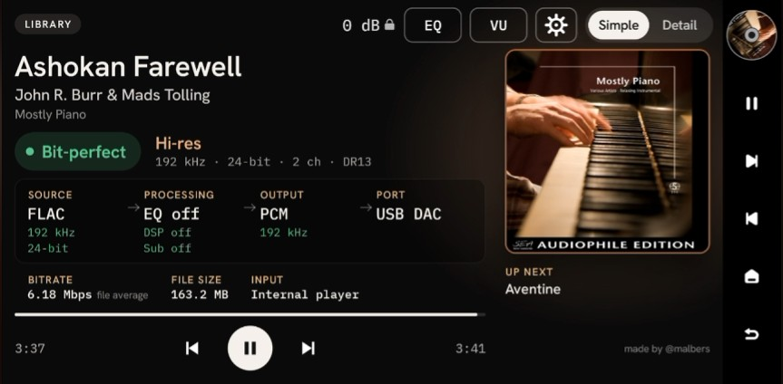

# EverSignal: now-playing stats for the Eversolo DMP-A6

**See every bit of your music, from the file to your DAC.** A free, read-only Android app that runs right on your Eversolo DMP-A6 streamer.

Are you a streaming nerd? Do you check the sample rate before the song title? Ever wondered whether that 24-bit TIDAL track really reaches your DAC untouched, or what your Eversolo is quietly doing to it on the way? **This player is for you.**

EverSignal is a now-playing screen for the Eversolo DMP-A6 that shows the whole signal path at a glance and tells you, in plain words, whether it's **bit-perfect**. Then it goes further: it measures how much your masters were compressed, and shows your album art the way the booklet meant it.

- **Bit-perfect verdict and signal path:** Source → Processing → Output → Port, with the step that changes your music shown in amber.
- **Dynamic Range:** DR, peak and loudness per track and per album, measured on the Eversolo itself, with the same numbers as foobar's DR Meter.
- **Full-Screen Album Mode:** every picture for the album, booklet scans included, plus lyrics in time with the music.
- **Apps checked too:** Apple Music and other apps on the Eversolo, including whether the EOS setting is letting their sample rate through.
- **Five pages of stats** for everything else the player reports.

**▶ Watch it in action (1 minute):** *Magical Mystery Tour* played from the library. EverSignal checks the signal path and calls it Bit-perfect at CD quality, then a tap on the cover opens Full-Screen Album Mode with all 7 pictures for the album, disc included.

https://github.com/user-attachments/assets/c1869368-19e8-4e4a-8ed3-7eeb2c798256

Your music keeps playing exactly as before; EverSignal just shows you what's going on.

**It only reads. It never writes.** No settings changed, no files touched, nothing in your library edited. The only things it ever asks the player to do are the buttons you tap: play/pause, next, previous, and the VU screen.

[](https://github.com/malbers/eversignal/releases)

**Contents**

- [Why did I build this?](#why-did-i-build-this)
- [What people are saying](#what-people-are-saying)
- [What you get](#what-you-get)
- [How to use it](#how-to-use-it)
- [What "Bit-perfect" means here](#what-bit-perfect-means-here)
- [What it never does](#what-it-never-does)
- [Download](#download)
- [How to Install](#how-to-install)
  - [Option A: from a USB thumb drive](#option-a-from-a-usb-thumb-drive)
  - [Option B: the Eversolo's upload page](#option-b-the-eversolos-upload-page)
  - [Option C: copy it over the network, then tap to install](#option-c-copy-it-over-the-network-then-tap-to-install)
- [Updating](#updating)
- [What's new](#whats-new)
- [Tested on](#tested-on)
- [More from the community](#more-from-the-community)
- [Feedback](#feedback)
- [Building from source](#building-from-source)
- [Credits](#credits)
- [Licence](#licence)
- [Other Eversolo Apps I made](#also-from-me)

## Why did I build this?

I always wanted to know what my DMP-A6 actually sends to my DAC. Is that TIDAL track really bit-perfect, or is something resampling it on the way? The player knows, it just doesn't show you. I was curious how much I could pull right on the device, and it turned out to be a lot. So I built a free app for it.

> **Made by Michael Albers.** I make honest videos about budget audio equipment, including a lot of Eversolo DMP-A6 how-tos. If you like this app, come find more on my YouTube channel: **[youtube.com/@malbers](https://www.youtube.com/@malbers)**

| The stock player screen | The same track in EverSignal |
|---|---|
| 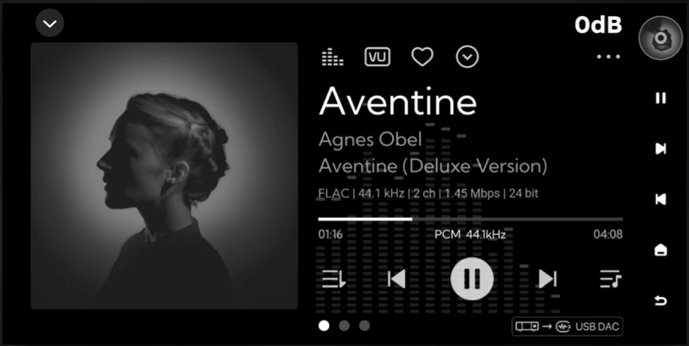 | 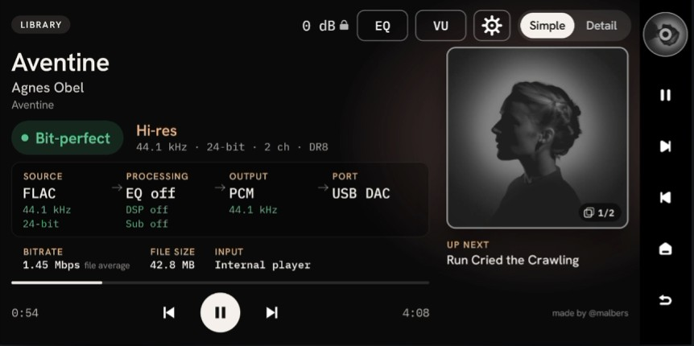 |

## What people are saying

### Real use: the DSD that wasn't native

Martin M. was playing a DSD file (DSF, 2.8 MHz) to his amp over HDMI and assumed it was going out as native DSD. EverSignal showed otherwise: the badge read **DSD → PCM**, so the player was converting it on the way out. After checking the A6's HDMI DSD setting and a restart, EverSignal showed **DSD64, native**, all the way to the port. In his words: "working now after I did a restart bloody great app I like it."

That's what it's for: the player knows what it's doing to your music, it just doesn't show you.

### From owners

> "Thanks to your program, I'm enjoying my music more than ever before."<br>
> **Václav H.**

> "I'm a technician. That's why I'm also interested in all the technical details of the music being played, and if I have access to them, I enjoy the music even more, because those technical details tell me something extra about it."<br>
> **Václav H.**

### From the Eversolo Facebook groups

> "I just installed it. Very impressive.😊 It's my new favourite toy.😁"<br>
> **Ian J.**

> "Great app! I realized that my HDMI output was no longer in Native DSD because I had left the EQ set to ON. So it was still in PCM!"<br>
> **Pierre C.**

> "Got it working on my A6. I love all the info it gives!"<br>
> **Jason M.**

> "Amazing amount of information you have managed to squeeze onto that size display. … A really lovely app, well done."<br>
> **Steven W.**

> "works perfectly on the T10. Bigger screen not fully used, but centred nicely"<br>
> **Steven C-H.**

> "A8 here, seems to work perfectly. Great work"<br>
> **Michael W. S.**

**[See more comments ↓](#more-from-the-community)**

## What you get

### Simple: the couch view

Big, readable from across the room:

- **Verdict badge:** Bit-perfect, Resampled, EQ active and more, with the quality next to it (CD quality, Hi-res, DSD) and the format: rate, bit depth, channels, and the track's **DR** once you've measured it. Tap the badge to see why.
- **Signal path:** Source → Processing → Output → Port. Green while your music passes untouched; the step that changes it turns amber.
- **Stats row:** bitrate, file size and input.
- **Source:** TIDAL, Apple Music, Amazon Music, AirPlay, or Library for your own files.
- **Controls:** play/pause, next, previous, up next, **VU** for the Eversolo's own meters, and **EQ** to open the Eversolo's EQ app (lit like the EQ active badge when EQ is on).
- **made by @malbers:** opens my YouTube channel.

| MQA from the library, sent to the DAC | EQ on: no longer bit-perfect, and it says so |
|---|---|
|  | 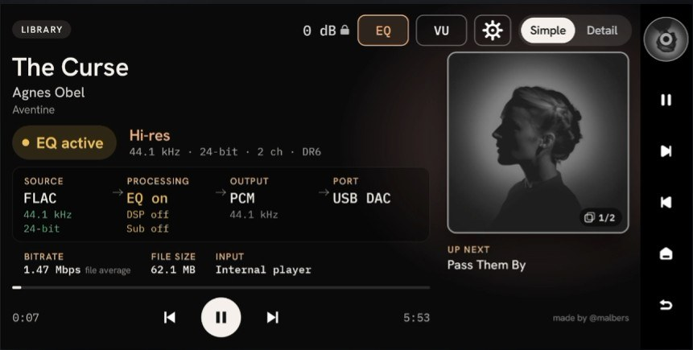 |

**Tap the badge** to see what it means on your player right now and, when you're not bit-perfect, a live checklist of what to change. Here, a Dolby Atmos file:

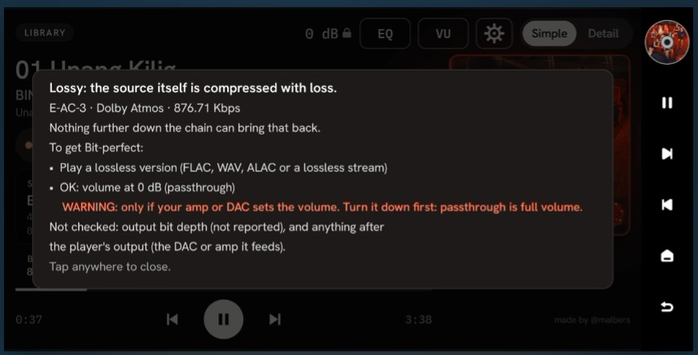

### Detail: stats for nerds

Tap **Detail**, then swipe left or right through five pages:

| Page | What's on it |
|---|---|
| 1. Overview | Music, signal path, device, today's listening session |
| 2. Track & file | Source, credits, file details, library data |
| 3. Queue & playback | Queue, up next, playback state |
| 4. Device | Model, firmware, memory, storage, network |
| 5. Inputs, outputs & volume | Every input and output, output settings, volume |

**▶ Watch it (2 minutes):** all five Detail pages while *Magical Mystery Tour* plays, including measuring the track's dynamic range (DR11, which then shows on the Simple screen too), and the Settings screen at the end. MAC addresses are blurred.

https://github.com/user-attachments/assets/fe0807f4-1d64-4df3-bfb6-6f8e861ea74f

Missing info shows as N/A, so you can see what each source reports.

### Dynamic range: how squashed is your master?

New in 1.0.13. On Detail page 2 (Track & file), tap **Measure track** or **Measure album**. EverSignal reads your files right on the Eversolo and shows each track's **DR**, **peak** and **RMS**, plus the album's DR. It's the same method as foobar2000's DR Meter, and on the same file it gives the same numbers.

- **DR** is how much the master was compressed: 14 and up is very dynamic, 8 to 13 healthy, 7 or below heavily compressed (the "loudness war").
- **Peak** is the loudest moment. A master that stops at exactly the same peak on every track (often -1.0 dB) has a limiter on it.
- **RMS** is the average loudness. The closer to 0, the louder and more squashed.

Measured once, remembered: the next time you play that album, its DR is just there, and the track's DR shows on the Simple screen too. It only reads your own files (not streams or apps), only when you tap Measure, and your music keeps playing while it works. Thanks to Pierre C. for the idea.

| One album, from DR6 to DR13: every track stops at -1.0 dB | The track's DR on the Simple screen |
|---|---|
| 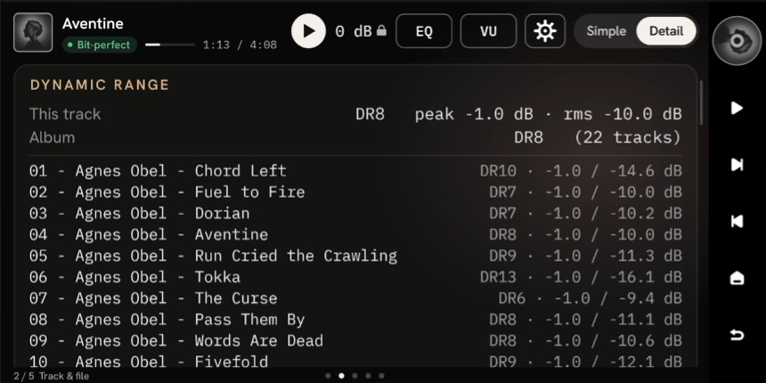 |  |

> "I think that this data is available only in Foobar and now (to my great joy) in EverSignal. The large audiophile community will have something to talk about again and the competition will probably be completely taken aback, because I haven't seen anything like it anywhere yet …"<br>
> **Václav H.**

### Full-Screen Album Mode

Tap the cover to see every picture for the album, booklet scans included, full screen. It flips through them on its own (set the speed on the Settings page), swipe to step through, tap to close. Here it is on Václav H.'s DMP-A6, with his booklet scans (thank you, Václav):

| | |
|---|---|
| 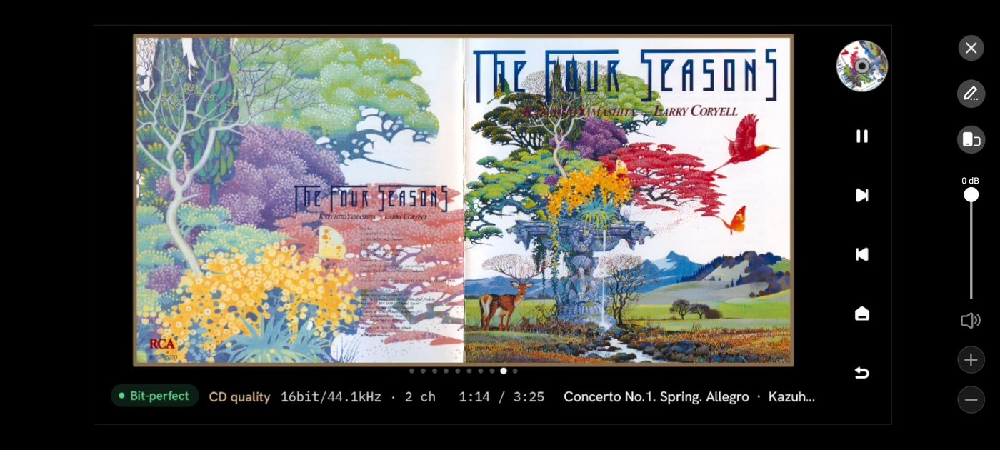 | 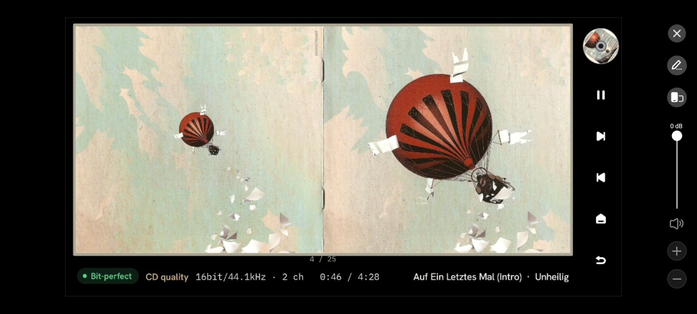 |

> "I think booklets are an essential part of the experience… Until now, this feature hadn't been available on the DMP A6. And now, thanks to you, it's available, and I'm enjoying it immensely. … So far, I'm not aware of any competitor that offers something similar."<br>
> **Václav H.**

**No booklet scans?** [AddMyCoverArt](https://github.com/malbers/addmycoverart) can find them. Open an album, tap **Find more art**, and it fetches the back cover, booklet pages, disc and tray from the Cover Art Archive into the album's `Scan` folder. Open Full-Screen Album Mode and they're there.

**Lyrics:** if a track has an `.lrc` file with the same name next to it, a **LYRICS** button appears in Full-Screen Album Mode and shows the words big, in time with the music. Thanks to Pierre C.

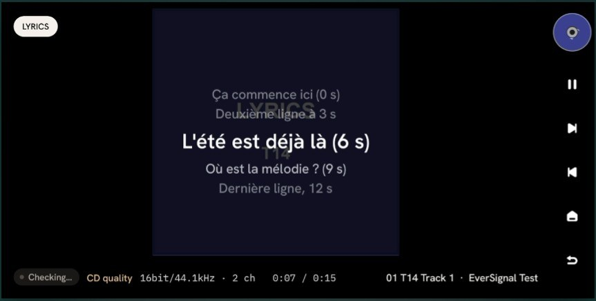

### Settings & about: the gear

Tap the **gear** at the top (next to VU) for the Settings & about page. Tap it again to go back.

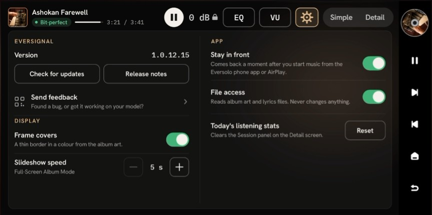

- **Version**, with **Check for updates** and **Release notes** (what changed in every version, right on the player).
- **Send feedback**: opens a QR code; scan it with your phone to send a bug, an idea, or "it works on my model".
- **Frame covers** and **Slideshow speed** (5 to 60 seconds) for Full-Screen Album Mode.
- **Stay in front**: an on/off switch (see [How to use it](#how-to-use-it)).
- **File access**: on/off. Off means EverSignal reads no files at all: no folder art, lyrics or DR, just the player's own cover.
- **Today's listening stats**: Reset clears the Session panel on Detail page 1. Tap Reset, then tap again to confirm. They also clear on their own at midnight.

Each page scrolls. Top and scrolled views:

| Page | Top | Scrolled |
|---|---|---|
| **1 Overview** | 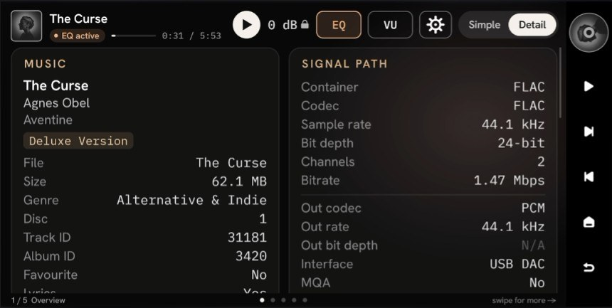 |  |
| **2 Track & file** | 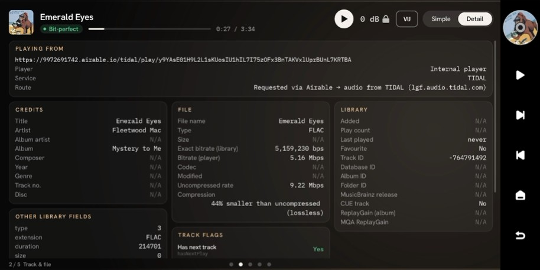 | |
| **3 Queue & playback** |  |  |
| **4 Device** |  |  |
| **5 Inputs, outputs & volume** |  | 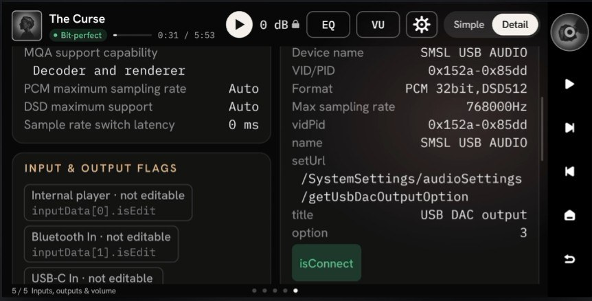 |

## How to use it

1. **Play some music** the way you always do: TIDAL, your library, the Eversolo phone app, AirPlay, anything.
2. **Press Home** on the Eversolo.
3. **Open EverSignal** from the **Apps** tab.
4. **Watch the stats.** Play/pause, next and previous work right there, and the Eversolo's own controls keep working as normal.

**Stay in front** (the switch on the Settings & about page, behind the gear): starting a track from the Eversolo phone app or connecting AirPlay makes the Eversolo jump to its own player screen. With Stay in front on, EverSignal comes back by itself a moment later. Music you start from the player's own file browser or library doesn't trigger it, because you left EverSignal yourself to go there. The first time, Android asks you to allow **Display over other apps**; turn it on, go back, and tap Stay in front again. It stays on until you switch it off, also when you leave with Back. It never traps the screen: it only comes back after you start music from the phone app or AirPlay.

### What devices does it work on?

EverSignal runs on the Eversolo itself, not on your phone. I built and test it on my DMP-A6 (Gen 1). Owners have confirmed it working on:

- DMP-A6 (Gen 1)
- DMP-A6 Master Gen 2
- DMP-A8
- DMP-T8
- DMP-T10 (uses the full width of its long screen from 1.0.4)
- Eversolo Play

It does not run on non-Eversolo Android boxes, and there is no iPhone or Android phone version. Tried it on a model that isn't listed? [Let me know](#feedback), works or not.

### My A6 doesn't support Atmos, so why does EverSignal show it?

Because the file is Atmos, even if your player can't output it. Atmos music files use Dolby's lossy E-AC-3 format, and the player can report them as ordinary 16-bit stereo, which is why earlier versions wrongly called them Bit-perfect ALAC. Knowing a track is lossy Atmos tells you you're not hearing the lossless version, which matters if you have the same album both ways.

## What "Bit-perfect" means here

Your music file is a long list of numbers. Bit-perfect means the exact same numbers that are in the file are the ones that leave the Eversolo: nothing added, nothing changed. Why make that the goal? You hear the recording as it was mastered, and your DAC gets to do the job you bought it for. It makes sure nothing in between is quietly changing the music. On its own it won't make a track sound better, and if you like EQ or upsampling, use them. Just know they're on.

The badge says **Bit-perfect** only when all of these are true:

- PCM goes out at the source's own sample rate (no resampling)
- EQ and DSP are off
- The volume is at 0 dB or locked, because digital volume changes the samples. (That's why volume passthrough is recommended, but ONLY if your DAC, preamp or amp controls the volume after the Eversolo. Passthrough sends full volume, so turn your amp down first.)

If one of these is not true, the badge says which one (Resampled, EQ active, Volume −12 dB). What it can't check: the output bit depth (the DMP-A6 never reports it), and anything after the Eversolo's output, like the DAC or amp it feeds.

### The other badges

- **Resampled:** the rate changes on the way out (say 44.1 kHz in, 96 kHz out). Check upsampling or a fixed output rate.
- **EQ active / DSP active:** EQ or a sound effect is changing the samples.
- **Volume −12 dB:** digital volume below 0 dB changes the samples. Fix: volume passthrough (0 dB), only if your amp or DAC has its own volume. **Turn it down first: passthrough is full volume.**
- **DSD native:** DSD goes out as DSD, untouched.
- **DSD → PCM:** DSD is converted to PCM. Check that output's DSD setting.
- **MQA to DAC:** MQA goes to your DAC, for the DAC to unfold.
- **MQA unfolded ×2 / ×4:** the player unfolds MQA itself.
- **Lossy (MP3, AAC, …):** the source itself is compressed with loss. Nothing downstream brings it back.
- **Hi-res stream:** the service says hi-res, but the player doesn't report its output, so no verdict.
- **Android app:** Apple Music, Amazon Music or another app playing on the Eversolo itself. The player doesn't report the app's own format, so there's no Bit-perfect verdict, only what goes out. Its sound goes through Android, so it needs the Eversolo's **EOS** setting on (Settings › Playback › Eversolo Original sampling-rate audio engine). With EOS off, Android resamples apps: on my A6, everything left USB at 192 kHz and optical at 44.1 kHz. EverSignal shows **EOS on** when the output rate proves it, and an amber **EOS off?** at 192 kHz over USB (unless the track really is 192 kHz). A change to EOS takes effect from the next track. The Eversolo's own player, TIDAL inside the player and TIDAL Connect don't go through Android, so EOS doesn't affect them.
- **Lossy (E-AC-3):** a Dolby (Atmos) track in an .m4a file. EverSignal reads the real format from the file itself, because the player can describe these as 16-bit stereo. The badge describes the file, not what comes out of your player: on the DMP-A6, Atmos doesn't come out as Atmos. The player decodes the file and sends it out as regular PCM.

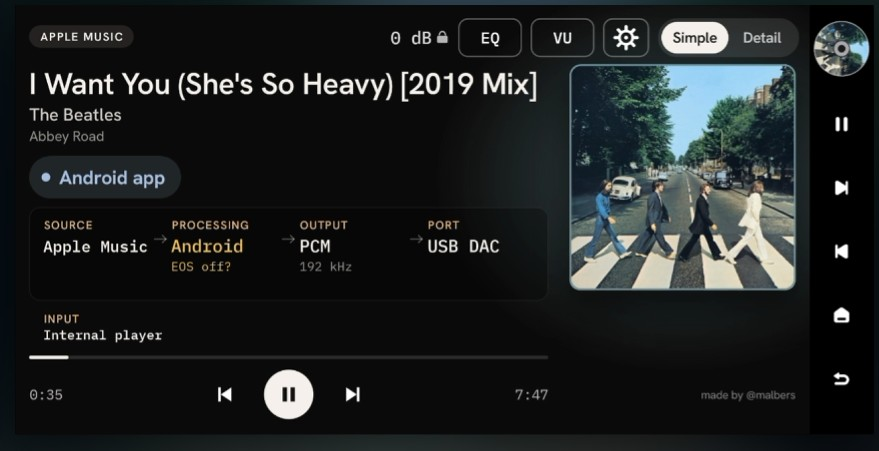

## What it never does

- **Never writes.** No settings changed, no files written, moved or deleted, no library or tag edits.
- **Reads only what the music needs (from 1.0.12):** with your OK, it reads the image files and lyrics files in the playing track's album folder (and one folder up for multi-disc sets), plus the art inside the playing file. Nothing else on your drive, and it never changes or deletes anything. Say no and EverSignal works as before.
- **Only does what you tap:** play/pause, next, previous, VU meters, and opening the EQ app. Switching EQ on or off is yours to do, in the Eversolo's own screen.
- **Measures DR only when you tap Measure:** it reads the music files in the playing album's folder, nothing else, and never changes them.
- **Stores almost nothing:** today's listening totals, your settings, the last update check, and the DR results you measured. All in its own app storage.
- **Talks only to your Eversolo.** Two exceptions: album covers load from the streaming service, and once a day it asks GitHub if there's a new version. That check sends nothing about you.
- **Never installs by itself:** tap the **Update** pill and it saves the new APK to **Download**. That's it.
- **Feedback goes through your phone:** the QR code opens the form on your phone, filled in with model, firmware, version and screen size. Never your network address, MAC or device ID.
- **No accounts, no analytics, no Google services.**
- **Blur before you share:** the **Device** page shows your network address, MACs and device ID. Streaming links never show their signed part.

## Download

[**Download the latest EverSignal**](https://github.com/malbers/eversignal/releases/latest): on the release page, click `EverSignal-<version>.apk` under **Assets**. This link always opens the newest version.

Download it to your laptop or desktop, not to the Eversolo. The next section shows how to get it onto the Eversolo.

## How to Install

**What you're doing:** an `.apk` file is an Android app. The Eversolo runs Android underneath, so it can install apps that aren't in its app store, usually called "sideloading". It takes a couple of minutes and you only do it once.

**For Options B and C:** your computer and the Eversolo must be on the same home network.

### Option A: from a USB thumb drive

No network needed.

1. **Copy the APK onto a USB thumb drive** (FAT32, exFAT or NTFS, which covers almost any drive).
2. **Plug it into a USB port on the back of the Eversolo.**
3. **Open the Files app**, pick the USB drive in the list on the left, and go to the folder with the APK.
4. **Tap the `EverSignal-<version>.apk` file, then Install.** If it asks to allow installs from unknown sources, turn that on for Files.
5. **Tap Done**, then find it in the **Apps** tab.

### Option B: the Eversolo's upload page

1. **Find the Eversolo's address.** On the Eversolo, go to **Settings > Network Settings > Transfer**. Under **Method 1** it shows a web address that starts with `http://` and ends in `:9587`.

   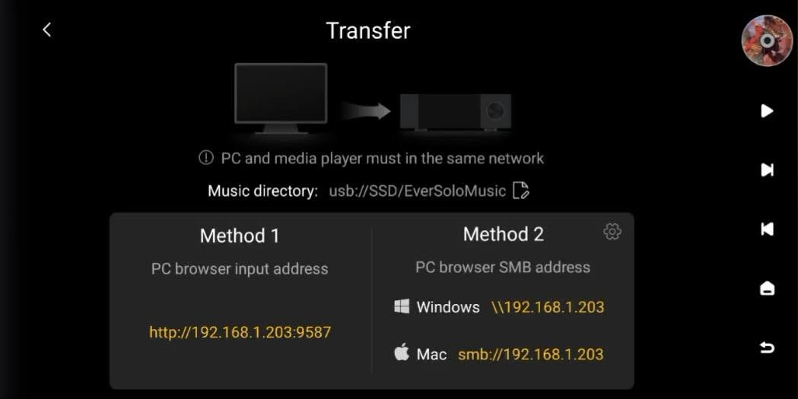

2. **Open that address on your computer** in any browser, including the `:9587` at the end. The Eversolo's upload page opens. Click **Upload Apk** at the right.

   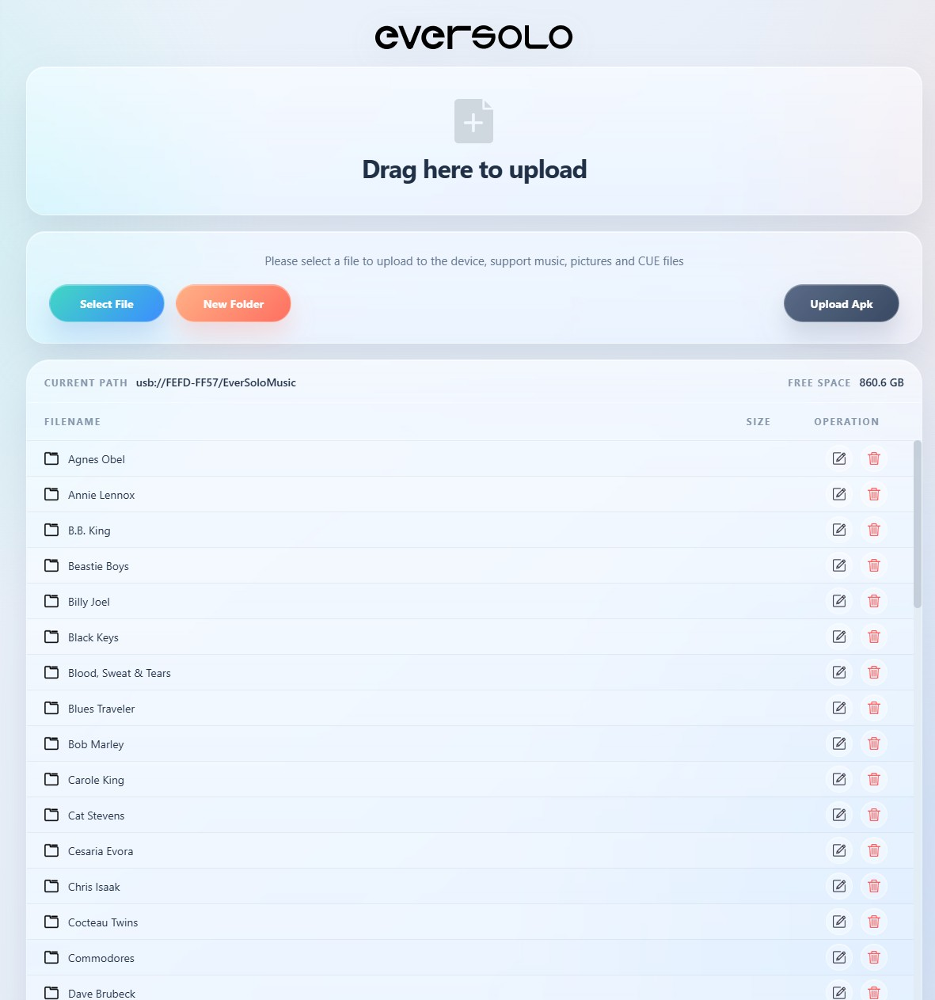

3. **Send the app.** Click **Select APK File** and choose the `EverSignal-<version>.apk` file from your Downloads folder. It uploads and installs by itself.

   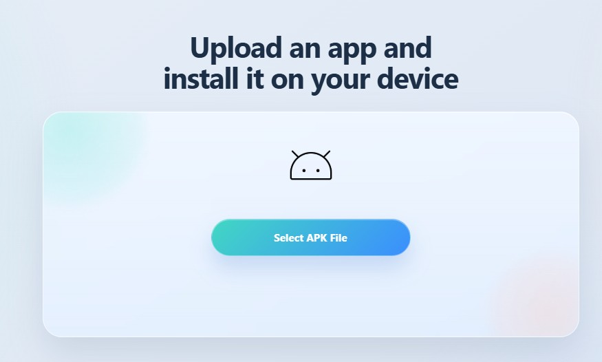

4. **Find it on the Eversolo** in the **Apps** tab on the home screen.

   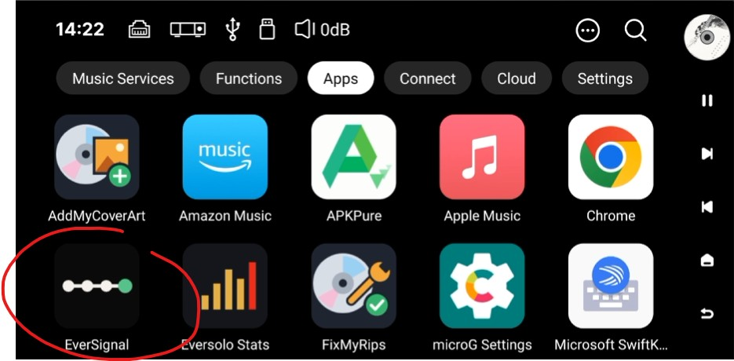

### Option C: copy it over the network, then tap to install

1. On the same **Transfer** screen, **Method 2** shows a network share address for Windows (starts with `\\`) and Mac (starts with `smb://`).
2. Open it on your computer: in Windows File Explorer type the `\\` address in the address bar; on a Mac use **Go > Connect to Server** with the `smb://` address (choose **Guest** if asked).
3. Copy the APK into any folder on the Eversolo, for example `Download` on the SSD.
4. On the Eversolo, open the **Files** app, go to that folder and tap the `EverSignal-<version>.apk` file. Tap **Install**.

   

5. **Tap Open** to start it now, or **Done** and find it later in the **Apps** tab.

   

### Is this file really from me?

Every official release is signed with the same key. If you want to check a copy you got somewhere else, its SHA-256 certificate fingerprint should be:

```
351e63f51b6bed49f8e5282c2cf1427ce8bb5e7fee3558ab4899c5b6ca146ca2
```

An APK with a different signer did not come from here.

## Updating

**Three ways to get a new version:** the **Update** pill under the cover (shows up by itself when a new version is out), the **gear › Check for updates** (right now), or download the APK yourself and install it like the first time (Options A to C above). Your settings stay.

From 1.0.1 on, EverSignal checks for a new version once a day. When one is out, tap **Update … · Download** under the cover. It saves the APK to **Download**. Then open **Files › Storage › Download**, tap the APK, and choose **Update**. Your settings stay. If you're on 1.0.0, install 1.0.1 by hand once, the same way you installed 1.0.0.

From 1.0.10, tapping the Update pill shows what's new in that version first, then **Download**. After you update, EverSignal shows what's new once when you open it.

**Want the update right now?** Tap the **gear**, then **Check for updates**. (On 1.0.9 or earlier: long-press **EverSignal** in Apps, choose **Clear data**, then open the app. It checks again straight away and the **Update** pill shows up. Clearing data only resets EverSignal itself: Simple or Detail, Stay in front, and today's listening stats. Nothing on your player changes.)

## What's new

**1.0.13** (22 November 2026)
- **Dynamic Range!** See how much a master was squashed, per track and per album: DR, peak and loudness, measured right on your Eversolo, with the same numbers as foobar's DR Meter. Detail › Track & file › **Measure track** or **Measure album**. The track's DR shows on the Simple screen too. Thanks to Pierre C.
- **Simple Redesign!** A cleaner Simple screen: a big verdict badge with the quality next to it, a signal path from Source to Port that turns amber exactly where your music gets changed, and bitrate, file size and input in one row.
- **New Settings!** Everything on one screen in two columns: a **Slideshow speed** for Full-Screen Album Mode (5 to 60 s), a **File access** switch, and Send feedback one tap away. File access switch thanks to Pierre C.
- **EOS, made visible!** Playing Apple Music or another app on the Eversolo? EverSignal shows **EOS on** when the Eversolo's original-sample-rate engine is passing the app's music through, and an amber **EOS off?** when Android looks to be resampling it to 192 kHz. Tap the badge for how to fix it.
- **Dolby Atmos files, fixed!** Atmos .m4a tracks no longer show as "Bit-perfect ALAC". EverSignal reads the real format from the file: E-AC-3, 5.1, Dolby Atmos. Thanks to Pierre C.
- **Smaller fixes:** the quality word in orange; the Eversolo's generic music-note picture counts as "no cover"; "Checking…" when you come back to EverSignal, instead of an old verdict.

**1.0.12** (20 November 2026)
- **Full-Screen Album Mode!** Tap the cover to see every picture for the album: front, back, inlay, booklet scans in a subfolder, even the art tucked inside your files. It flips through them on its own every 10 seconds, even while paused. Swipe to step through, tap to close. Dots show where you are, and a tiny **1/3** in the corner of the cover tells you there's more to see. Thanks to Václav H.
- **Lyrics!** If a track has an `.lrc` file with the same name next to it, a **LYRICS** button appears in Full-Screen Album Mode and shows the words big, in time with the music. Thanks to Pierre C.
- **Missing covers, fixed!** EverSignal now finds your covers itself, straight from the album folder: `cover.jpg`, `folder.jpg` or the art inside your files. Multi-disc sets with the cover one folder up work too. No more blank squares or generic music notes. Thanks to Václav H. and Pierre C.
- **Channels on screen!** `24-bit · 2 ch`, `1-bit · 5 ch`, right on the Simple screen and in Full-Screen Album Mode.
- **Framed covers!** A thin border in a colour picked from the art. Prefer it plain? Switch it off on Settings & about. Thanks to Václav H. for the idea.
- **VU button, fixed!** It goes to the VU meters and stays there, no more bouncing back. Thanks to Pierre C.
- **Stay in front, smoother!** Allow the permission once and it switches on by itself.
- **One new permission:** EverSignal asks to read your files, so it can show the art in your album folders and your lyrics. It asks in the What's new screen, with the reason, never out of the blue. It only reads. It never changes or deletes anything.

**1.0.11** (19 November 2026)
- **Clearer updates!** While an update downloads you see its progress, also on Settings › Check for updates. If it fails you see why (for example "not enough space"), and a download that stops moving is cancelled after a minute instead of hanging. Thanks to Coffee M.
- **EQ, the way the Eversolo really does it!** The Eversolo only applies EQ to its own player, stereo PCM up to 192 kHz. For DSD, multichannel, higher sample rates and AirPlay or casts it passes the music through untouched, so EverSignal now says **EQ skipped** there. Thanks to Pierre C.
- **AAC, matched!** It shows 16-bit, the same as the Eversolo's own screen.
- **Stay in front, sticky!** It stays on when you leave with Back. Only a tap on the switch itself turns it off.
- **Easier QR code!** Bigger blocks on the Feedback page, easier for a phone to read.
- **More patient covers!** If the player first says a track has no cover, EverSignal asks again a couple of times before giving up.

**1.0.10** (18 November 2026)
- **Settings & about page!** Tap the **gear** at the top (tap it again to go back). It has your version, **Check for updates**, **Release notes**, the **Stay in front** switch, **Reset** for today's listening stats, and the feedback QR code. The swipe pages are back to the five stats pages.
- **A real Stay in front switch!** It used to hide at the bottom of Detail page 1, and it now comes back faster after you start music from the Eversolo phone app or AirPlay.
- **What's new, built in!** After an update, EverSignal shows what's new once. Tapping the Update pill shows what's new in that version before you download.
- **Faster covers!** They load in the background and retry if the player is slow to send them.
- **A tidier header!** The Simple / Detail switch is a little narrower, so the track time always fits in the Detail header.

**1.0.9** (17 November 2026)
- **A neater Simple screen!** The play controls sit centred on the whole screen, Up next moved under the cover, and the rows have a little more space between them.

**1.0.8** (17 November 2026)
- **Apple Lossless, fixed!** ALAC .m4a files no longer show as Lossy. EverSignal now tells ALAC from AAC inside an .m4a, and shows the true rate for hi-res ALAC (the player reports a 96 kHz ALAC file as 48 kHz in one place). Thanks to Nic S. for reporting it.
- **"Checking…" badge!** While a new track settles, the badge shows a grey "Checking…" instead of a blank.
- **Centred controls!** The play controls sit centred under the progress bar. Thanks to Bruce M.
- **Readable bitrate!** The Bitrate tile reads in kbps / Mbps.

**1.0.7** (17 November 2026)
- **File browser covers, fixed!** Album covers now show for songs you start from the file browser (folders on your drive), not only from the Library. Thanks to Jaro S. and Giuseppe V. for reporting it.

**1.0.6** (16 November 2026)
- **EQ button!** It sits next to VU: one tap opens the Eversolo's EQ screen, where you switch EQ on or off. It lights up like the EQ active badge when EQ is on.
- **A steadier badge!** It only changes once the new verdict has held for two seconds, so switching EQ or starting an MQA file no longer flashes through in-between badges.
- **Pause, fixed!** Pausing a file no longer shows "Resampled". While paused, the Eversolo reports a stand-in output (PCM 192 kHz), so EverSignal keeps showing what the track played at.
- **Passthrough warning!** Every badge panel that mentions volume passthrough now carries a red WARNING. Passthrough is full volume.
- **Update hint, fixed!** It now points to Files › Storage › Download.

**1.0.5** (16 November 2026)
- **Tap the badge!** Bit-perfect, Resampled, EQ active and the rest: see what it means on your player right now. When you're not bit-perfect, it shows a live checklist of what to change, volume passthrough first, with a caution to turn your amp down before you do.
- **SACD area, fixed!** It showed Stereo when the Eversolo's Preferred SACD area was set to Multichannel. Thanks to a French DMP-A6 owner for the report through the feedback form.

**1.0.4** (16 November 2026)
- **Wider screens!** On the DMP-T10's long display, EverSignal now uses the full width instead of leaving bands at the sides. Simple stretches the signal path and tiles; Detail shows three columns. The A6 looks the same as before. Thanks to Steve C.-H. for sending his T10's screen size.
- **Device panel, fixed!** On models that list more inputs (the DMP-A6 Master Gen 2 has six), the Device panel on the first Detail page no longer runs its outputs into the "can do" line. Thanks to René G. C. for the report.
- **Mouse wheel!** Scroll the Detail pages with a mouse wheel (for example through the Eversolo's PC control in a browser); a sideways scroll changes page.

**1.0.3** (16 November 2026)
- **Feedback page!** The last Detail page: scan the QR code with your phone to send a bug, an idea, or "it works on my model". It fills in your model, firmware and EverSignal version for you.
- **Screen size!** The **Device** page now shows the screen size and the area EverSignal gets, to help lay it out on other models (the T10's bigger screen is next).

**1.0.2** (15 November 2026)
- **Bigger everything!** Text readable standing at the rack: Detail is drawn 1.8x larger in two columns, and every page scrolls (page 1 too).
- **A clearer Simple screen!** Smaller cover, larger signal path, tiles and badge line; second lines in green, labels in tan.
- **Easier controls!** Larger Simple / Detail, VU and volume controls at the top right, easier to hit.
- **Smarter Up next!** It shows the format on the same line; long values wrap under their label.

**1.0.1** (15 November 2026)
- **Update check!** Once a day it asks GitHub for the latest release, and shows an Update pill when a newer one is out. Tap it to download, no browser needed.

**1.0.0** (15 November 2026)
- **First public release!** Simple and Detail screens, the bit-perfect verdict, five stats pages, today's listening session, Stay in front.

## Tested on

Eversolo DMP-A6 (Gen 1), firmware 1.6.15, Android 11, with the library (FLAC, WAV, DSD, MQA, MP3), TIDAL, Apple Music, Amazon Music, AirPlay and TIDAL Connect, on XLR/RCA and USB DAC outputs. Owners report it working on the DMP-A6 Master Gen 2, DMP-A8, DMP-T8, DMP-T10 and the Play. It does not run on non-Eversolo Android boxes.

EverSignal is an independent app. It is not made by or affiliated with Eversolo, and it reads the player's undocumented local interface, which a firmware update could change.

## More from the community

More from the Eversolo Facebook groups:

> "I installed it on my DMP A8 and my eversolo play qorks awesome on both"<br>
> **Sylvain A.**

> "Fantastico su T8 grazie !!!"<br>
> **Giuseppe V.**

> "I've installed an apk using a USB, but not directly. So straightforward!"<br>
> **Steve G.**

> "Great job !! Thanks for that."<br>
> **Fred F.**

> "Just loaded it.....good info for sure. Thanks"<br>
> **Stuart G.**

> "Very nice ! thank you"<br>
> **René G. C.**

> "Amazing, thanks for sharing."<br>
> **Sérgio P.**

> "Thanks for making this. Works perfect."<br>
> **Henri S.**

> "You sir are a clever little cookie"<br>
> **Martin M.**

> "I'm really enjoying this. Thanks!"<br>
> **Michael K.**

> "by the way, it looks like a great product. Thank you."<br>
> **David S.**

> "Pretty awesome!"<br>
> **Weston T.**

> "Congrats and Thanks for your APP."<br>
> **Patricio M.**

> "Very cool!"<br>
> **Lou S.**

> "Nice, thanks!"<br>
> **Emilio M.**

## Feedback

Found a bug, have an idea, or tried it on another Eversolo model? Easiest: tap the **gear** and scan the QR code with your phone. Or **[tell me here](https://docs.google.com/forms/d/e/1FAIpQLSdaQcFaXOcaRyZr520Lxir_NmPKtZG6aojfJ15XBwSbSB9ffQ/viewform)**. It's a short form, no account needed, and I read every one. If you're on GitHub, you can also [open an issue](https://github.com/malbers/eversignal/issues). A screenshot of the Detail pages helps a lot (blur the Device page first).

## Building from source

Java, plain Android SDK, no third-party libraries. JDK 17, then:

```
gradlew assembleRelease testDebugUnitTest
```

Release builds are signed with a key kept outside the repo (`scripts/new-signing-key.ps1`); without it they fall back to the debug key.

## Credits

Fonts: [Hanken Grotesk](https://fonts.google.com/specimen/Hanken+Grotesk) and [IBM Plex Mono](https://fonts.google.com/specimen/IBM+Plex+Mono), both under the SIL Open Font License 1.1 (licence texts in `app/src/main/assets/fonts/`). See [THIRD_PARTY.md](THIRD_PARTY.md).

## Licence

Copyright 2026 Michael Albers ([@malbers](https://www.youtube.com/@malbers)). Licensed under the [Apache License 2.0](LICENSE).

You're welcome to use it, modify it, build on it and send improvements. If you redistribute it or something built from it, keep the [NOTICE](NOTICE) file with it so the credit travels along. The licence doesn't cover the name: please don't publish a modified version as "EverSignal" or as coming from me.

Contributions are welcome. Anything you submit to this repository is accepted under the same Apache 2.0 licence.

## Also from me

Two more free apps for the DMP-A6:

- **[AddMyCoverArt](https://github.com/malbers/addmycoverart)** fills in missing album art on your ripped CDs, finds booklet pages, back covers and disc art for any album, and checks your rips for missing or cut-short tracks, right on the Eversolo.
- **[FixMyRips](https://github.com/malbers/fixmyrips)** fixes the tags the Eversolo CD Ripper leaves broken, and tells you from your phone whether a CD is already ripped.

And the videos that go with all three: **[youtube.com/@malbers](https://www.youtube.com/@malbers)**
